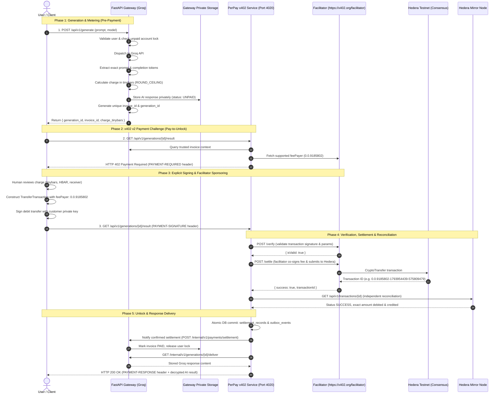
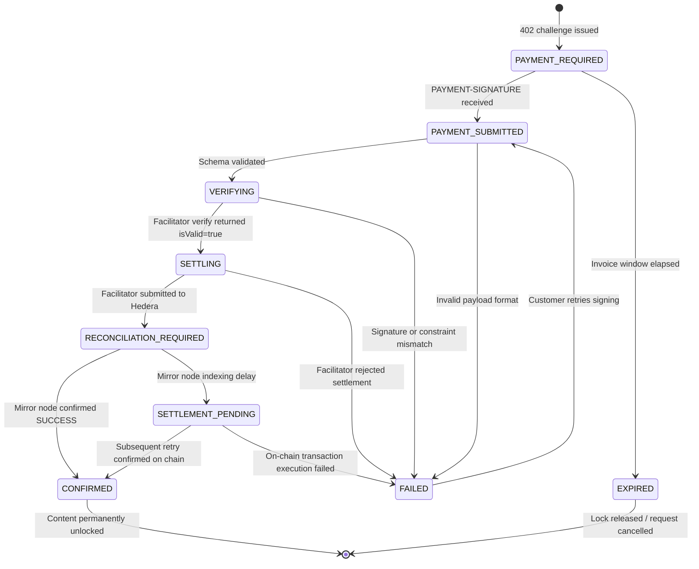

# PerPay Payment Flow — x402 v2 Hedera Exact Settlement

## Overview

PerPay uses a **post-generation, exact-usage invoice and pay-to-unlock** payment sequence.
Unlike traditional fixed subscriptions or upfront paywalls, PerPay generates the AI output with Groq first, calculates the exact billing amount down to integer tinybars based on actual prompt and completion tokens, stores the result privately in the FastAPI gateway, and presents an x402 v2 payment challenge to the customer.

No response content is unlocked until on-chain settlement is verified and confirmed on Hedera Testnet.

---

## Architecture Sequence Diagram

---

## State Machine Transitions

---

## Safe Delivery & Recovery Guarantees

1. **Fail-Closed Content Gating**:
   No bytes of the generated AI completion leave the service before the Hedera Mirror Node confirms that the transaction succeeded and credited the exact integer tinybars to the PerPay receiver account.

2. **Durable Local Storage & Outbox**:
   Confirmed settlements are written to SQLite using ACID transactions alongside an outbox entry. If the FastAPI gateway is temporarily offline or restarting, the settlement evidence is retained, and the outbox background service retries delivery with exponential backoff.

3. **Zero Double-Billing on Reconnect**:
   If a client pays, receives a network disconnect, and reconnects minutes later:
   - Requesting `GET /api/v1/generations/{generation_id}/result` looks up the confirmed settlement in SQLite.
   - It recognizes that the invoice is already paid and immediately releases the stored completion (HTTP 200) without requesting payment a second time.
